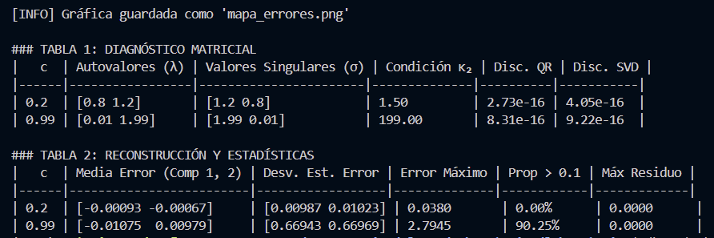
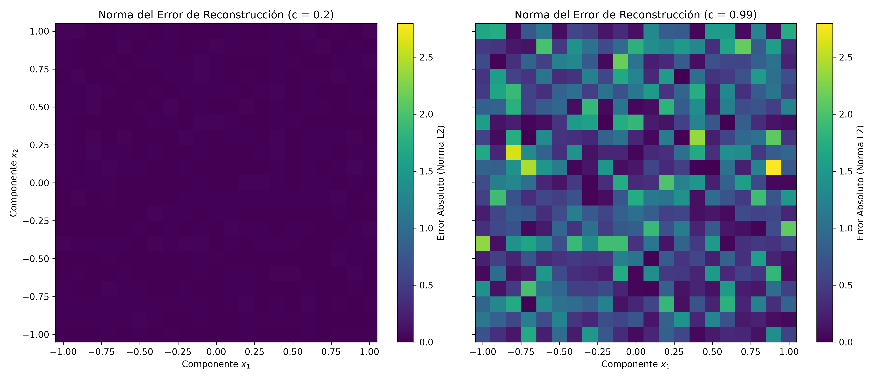
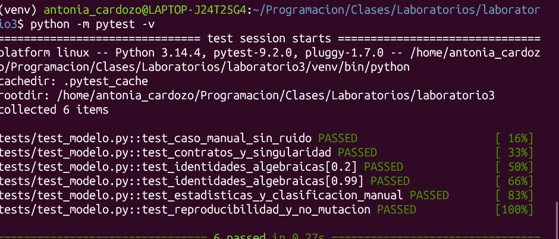

# Informe #3 — Laboratorio 3: Reconstrucción de señales y sensibilidad con NumPy

**Estudiante:** María Antonia Cardozo  
**Parámetros:** Malla `21 × 21` en `[-1, 1]`, semilla `default_rng(7)`, ruido $\mathcal{N}(0, 0.01^2)$, configuraciones $c = 0.2$ y $c = 0.99$.

---

## 1. Resultados Experimentales

### Tabla 1: Diagnóstico Matricial

|   c  | Autovalores ($\lambda$) | Valores Singulares ($\sigma$) | Condición $\kappa_2$ | Disc. QR | Disc. SVD |
|------|-------------------------|-------------------------------|----------------------|----------|-----------|
| 0.2  | `[0.8, 1.2]`            | `[1.2, 0.8]`                  | 1.50                 | 2.73e-16 | 4.05e-16  |
| 0.99 | `[0.01, 1.99]`          | `[1.99, 0.01]`                | 199.00               | 8.31e-16 | 9.22e-16  |

### Tabla 2: Reconstrucción y Estadísticas

|   c  | Media Error (Comp 1, 2) | Desv. Est. Error | Error Máximo | Prop > 0.1 | Máx Residuo |
|------|-------------------------|------------------|--------------|------------|-------------|
| 0.2  | `[-0.00093, -0.00067]`  | `[0.00987, 0.01023]` | 0.0380   | 0.00%      | 0.0000      |
| 0.99 | `[-0.01075,  0.00979]`  | `[0.66943, 0.66969]` | 2.7945   | 90.25%     | 0.0000      |

### Figura 1: Mapa espacial del error de reconstrucción

pytest 
### Figura 2: Evidencia de ejecución de pruebas automatizadas (pytest)

---

## 2. Discusión y Respuestas

1. **¿Qué diferencia hay entre `*` y `@` en este problema, y qué errores de formas podrían pasar inadvertidos?**  
   El operador `*` ejecuta multiplicación elemento a elemento (producto de Hadamard), mientras que `@` realiza el producto matricial estándar. Si se usa `*` por error entre una matriz `(2, 2)` y un arreglo de señales `(2, 2)` (en un caso de prueba pequeño), NumPy multiplicará componente a componente sin lanzar error de dimensiones. En arreglos `(2, 441)` lanzaría un error de *broadcasting*, pero en casos cuadrados pasaría totalmente inadvertido alterando el modelo físico.

2. **¿Qué aportan autovalores, QR y SVD a la verificación o interpretación? ¿Por qué no basta con imprimir sus salidas?**  
   Permiten auditar la estructura geométrica y la estabilidad numérica del sistema $A(c)$. Imprimir las matrices crudas en consola no basta porque el ojo humano no puede comprobar ortogonalidad perfecta ni detectar errores de redondeo de punto flotante; calcular las normas de discrepancia ($\|QR - A\|$, $\|Q^T Q - I\|$, $\|U\Sigma V^T - A\|$) demuestra cuantitativamente que las identidades se cumplen dentro de la tolerancia de máquina ($\sim 10^{-16}$).

3. **¿Cómo relacionan la dirección difícil de reconstruir con $\kappa_2$ y los errores observados? ¿Por qué $\kappa_2$ no es una predicción exacta de cada error absoluto?**  
   Para esta matriz real simétrica, el autovector asociado al menor autovalor ($\lambda_{\min} = 1 - c$) coincide con la dirección del menor valor singular ($\sigma_{\min}$). En esa dirección ($x_1 = -x_2$), los sensores casi restan las componentes entre sí y atenúan la señal por un factor de $0.01$ cuando $c=0.99$. Al invertir el sistema para reconstruir, el ruido en esa dirección se amplifica proporcionalmente a $\kappa_2 = \sigma_{\max}/\sigma_{\min} = 199$, elevando el error máximo de `0.0380` a `2.7945`. Sin embargo, $\kappa_2$ mide la amplificación relativa en el peor caso posible, por lo que funciona como una cota superior y no predice el error absoluto puntual de cada señal, el cual depende de qué tanto se alinee el ruido aleatorio de cada muestra con ese autovector crítico.

4. **¿Por qué el residuo puede ser pequeño aunque la reconstrucción sea mala? ¿Qué cambia en $c=1$?**  
   Cuando $c = 0.99$, la matriz está mal condicionada ($\kappa_2 = 199$): vectores $\hat{x}$ muy alejados de la señal real $x$ producen lecturas $A\hat{x}$ casi idénticas a $b$ porque las columnas de $A$ son casi colineales. Así, `linalg.solve` encuentra una solución exacta para los datos ruidosos (residuo $\approx 0$), pero muy lejana a la señal original. Si $c = 1$, ambas filas y columnas de $A$ son idénticas, su determinante es cero y la matriz se vuelve **singular** (no invertible), perdiendo la unicidad de la solución e impidiendo reconstruir las componentes individuales.

5. **¿Qué eje se reduce en cada estadística, cómo usaron *broadcasting* y cómo protegieron el arreglo original?**  
   Se redujo el **Eje 1** (`axis=1`, las 441 señales) para obtener la media y desviación estándar por cada componente del sensor, y el **Eje 0** (`axis=0`, las 2 componentes) para calcular la norma euclidiana del error por señal. Al calcular la media con `keepdims=True` (forma `(2, 1)`), se utilizó *broadcasting* para restarla directamente de la matriz de errores `(2, 441)` sin bucles. Para mantener intacta la señal original, `generar_malla_senales()` usa `.flatten()`, lo que fuerza a NumPy a crear copias independientes en memoria en lugar de vistas referenciales.

---

## 3. Nota — Antonia Cardozo

 * **Predicción inicial:** Antes de ejecutar el experimento, al comparar c=0.2 con c=0.99 esperaba que el error incrementara, debido al ruido que genrarían las dos mediciones al estar tan cerca entre ellas. 
* **Prueba explicada:** Las pruebas dek archivo  `tests/test_modelo.py`buscan generar un control de calidad automatizado, este verifica y garantiza la exactitud matemática, revisa el manejo de errores y se asegura de la integridad de los datos, compara los valores del programa con los que conocemos. 

La función (´test_identidades_algebraicas´) busca verificar  que los autovalores, QR y SVD, cumplan los teoremas matemáticos para ambos valores de c.

Funciona por medio de @pytest.mark.parametrize  para automatizar la prueba tanto para c=0,2 como para c=0,99.

También comprueba y verifica tres identidades:

1. Que A V = V Λ (los autovectores y autovalores reconstruyen la acción de la matriz).

2. Que Q R = A y que \(Q^T Q = I\) (la matriz Q es  ortogonal).

3. Que \(U \Sigma V^T = A\) (la descomposición en valores singulares reconstruye la matriz original sin presentar errores de transposición)

* **Decisión de implementación:** se uso la estructura de columnas `(2, 441)` para separar los valores provenientes de las dos señales, así obtendría cada componente en una fila y cada señal independiente en una columna. Esto a su vez permite asegurar la compatibilidad con la fórmula matemática, ecuación b= Ax; por otro lado permite la resolución simultanea de ciclos en una sola llamada; finalmente permite tener una mayor claridad en los ejes estadísticos manteniedno una regla fija en todo el programa Eje 0 representa los dos sensores y Eje 1 recorre las 441 muestras. 

---

## Referencias 

• Documentación oficial de NumPy (Álgebra Lineal): NumPy Developers. (2024). Linear algebra (numpy.linalg) — NumPy v2.1 Manual. numpy.org
• Documentación oficial de NumPy (Broadcasting): NumPy Developers. (2024). Broadcasting — NumPy v2.1 Manual. numpy.org
• Documentación oficial de NumPy (Copias y vistas): NumPy Developers. (2024). Copies and views — NumPy v2.1 Manual. numpy.org
• Texto guía de Álgebra Lineal Numérica (Condicionamiento y SVD): Trefethen, L. N., & Bau III, D. (1997). Numerical Linear Algebra (Lecture 12: Conditioning and Condition Numbers; Lecture 5: Singular Value Decomposition). SIAM.
